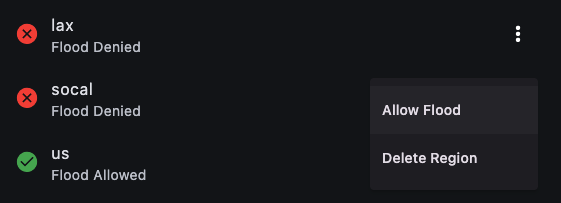
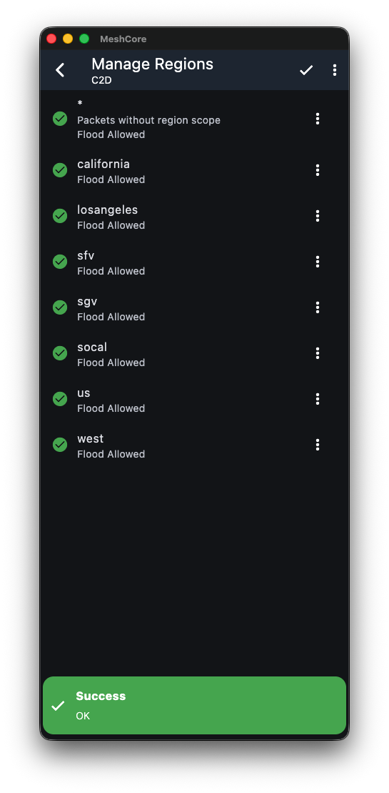

# Adding Regions to Repeaters

To forward scoped traffic, a repeater must have the right **regions** defined and **flood allowed** for each region. You can do this in two ways: via the **GUI** (remote admin) or via the **CLI** (serial or remote).

Recommended region hierarchy for Southern California: `*` → `us` → `california` → `socal` → counties and other local areas. You can reference [this map](https://regions.wcmesh.com) or you can set up and copy the commands into your repeater using [this page](https://matkam.github.io/meshcore-settings/#socal)

For how regions and scopes work, see [Implementing Regions](index.md).

## Add via MeshCore App GUI

Remote admin into your repeater. Click on the Settings tab then scroll down to where it says Manage Regions


Click the three dots in the upper right and click Add Region. Input the name of the region you want to add then click on the checkmark. Repeat for as many regions as you want to add. Once that is done, you should see a list of regions. If you are on older firmware, you may have to allow flood for the region. Click the three dots next to the region name and click allow flood.



Once you have all your regions set to allow flood, click the checkmark in the upper righthand corner. If you don't do this, the regions will not save in your repeater and you will have to repeat this process again. When you get the Success OK, your repeater can now forward scoped messages.



## Add via CLI

Depending on what firmware version you have on your repeater, the steps to adding regions may differ.

### 1.14 or older

With 1.14 and older, when adding a region, it was defaulted to **denyf**. You have to explicitly **allowf** a region in order for it to forward the scoped message. Use `region put {name}` if you don't want to have the region attached to a parent, or `region put {name} {parent}` to attach to a parent region. Input the parent region first, then add the child attached to the parent, allowing flood for each region with the command `region allowf {name}`. After you are done, use the command `region save` to save the regions settings to your repeater.

```text
region put us *
region allowf us
region put west us
region allowf west
region put california west
region allowf california
region put socal california
region allowf socal
region put losangeles socal
region allowf losangeles
region put orange socal
region allowf orange
region put sandiego socal
region allowf sandiego
region save
```

### 1.15

Firmware version 1.15 changed the default setting of **denyf** to **allowf**, eliminating the step to explicitly allow flood a region. Use `region put {name}` if you don't want to have the region attached to a parent, or `region put {name} {parent}` to attach to a parent region. Input the parent region first, then add the child attached to the parent. After you are done, use the command `region save` to save the regions settings to your repeater.

```text
region put us *
region put west us
region put california west
region put socal california
region put losangeles socal
region put orange socal
region put sandiego socal
region save
```

### 1.16 or newer

Introduced in 1.16 is a new command called `region def`, which allows you to define your regions in one line. Placing a region name after another will step it down the hierarchy tree. To reset to a certain level, use `|` folowed by the region you want to use as the parent. Example: `region def us west california` will place `west` as the child of `us` and `california` as the child of `west`. Doing `region def us west|* calfirnia|* socal` will place `west` as the child of `us`, then reset to make `california` the child of `*`, then reset to make `socal` another child of `*`. Perform a `region save` to save the settings into your repeater.

```text
region def us west california socal losangeles|socal orange|socal sandiego
region save
```

### Load multiple regions (with hierarchy)

Use `region load` to define several regions and their flood permissions in one go. Each line is a region name; **indentation** (spaces) sets the parent; **`F`** means flood allowed. End with a blank line.

```text
region load
* F
 us F
  west F
   ca F
    socal F
     losangeles F
     sandiego F
     orange F
    centralvalley F
     kern F

region save
```

## Useful commands

| Command | Purpose |
|--------|--------|
| `region` | List all regions and flood permissions (serial only) |
| `region list allowed` | List regions that have flood allowed (ver 1.12+) |
| `region put <name> [parent]` | Add or update a region |
| `region allowf <name>` | Allow flood for that region |
| `region denyf <name>` | Deny flood for that region |
| `region remove <name>` | Remove a region (no children allowed) |
| `region save` | Save region map to storage |