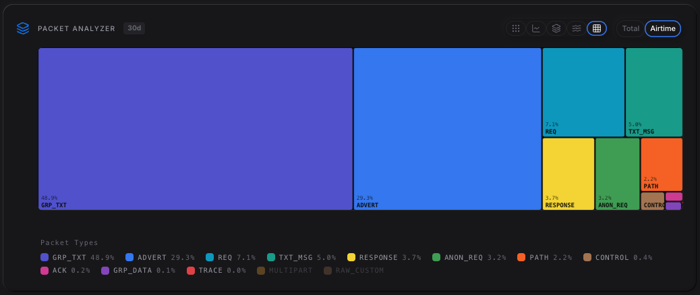
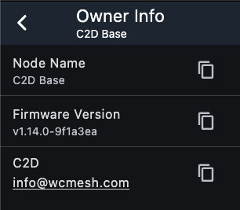
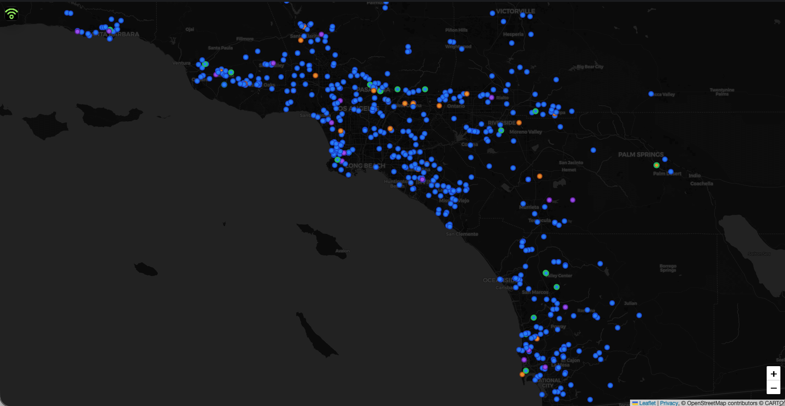

# State of the Mesh
7/26/2026

Again, I want to say ***Thank You All*** for putting in effort to contribute to this mesh. Every day I see new repeaters and companions appear on the mesh. It really is a testament to how MeshCore is a huge community effort, and you all make this community great.

:::note
*The following is not a definitive stance of the mesh. We are a community. Not a single person can police the mesh. All topics are open to discussion.*
:::

## Packet Breakdown

Here is a breakdown of the packet types:

| Packet| Description |
| --- | --- |
| GRP_TEXT | Channel (public or private) messages |
| TXT_MSG | Peer to peer message: DMs, cli commands |
| ADVERT | Notifies receivers that a node exists, and gives information about the node |
| ACK | An acknowledgement that a message was received |
| PATH | Path route a packet took from the original author |
| REQ | Requests to a known node (logged in as admin) |
| ANON_REQ | Requests to a node when not logged in (log in attempt, status, owner info, telemetry) |
| RESPONSE | Node response to requests or anon requests |
| CONTROL | Discovery requests |
| TRACE | Trace routes |
| GRP_DATA | Not handled |

Adverts have come down *a lot*, thanks to everyone setting their time intervals to the recommended 24-48h. Now that the firmware defaults to 48h, I actually think we can start doing more, almost **72-96h**, as adverts aren't really necessary on the mesh. There are other settings introduced in 1.16 that affect adverts which I talk about below.

For this second quarter of 2026, Apr - Jun, looking at GRP_TEXTs, we were averaging 1,332 messages a day. We averaged 335 Public channel messages, 601 test/bot channel messages (sending a bot command, getting a response, and general chit chat within the channels), and 504 wardrive pings.

We are starting to hit that 20%-25% threshold before the mesh starts getting overwhelmed. I for one think there are too many bots. We can try to limit them to where they are only ack bots, with no other commands (weather, hfcond, joke, etc). I would like to keep the mesh healthy and not have it crumble. We also don't want to turn into Meshtastic where it is just test/ack messages and no real discourse. Can discuss further.

| 4/1-6/30 | Avg/Day | /Week | /Month |
| --- | --- | --- | --- |
| All GRP_TEXT | 1,332 (+170) | 7,991 (+1,021) | 37,291 (+7,089) |
| Public | 335 (+31) | 2,009 (+187) | 9,374 (+1,479) |
| Tests/bots | 601 (+116) | 3,608 (+727) | 16,655 (+4,170) |
| Wardrive | 504 (+88) | 2,916 (+525) | 13,593 (+3,772) |

*Messages (diff from Q1)*

## Repeater updates

#### flood.max.advert
The new command **flood.max.advert** limits the number of hops for an advert flood message. Starting with 1.16.0, the default is set to **8**. Realistically, this is a good default, as we have observers within that limit for each repeater. You don't need repeaters in your contacts to send a message. The MeshCore app (and others) now allows you to send your contact info in a channel, so no need to advert your companion, unless you want to. Command `set flood.max.advert {value (0-64)}`

I'm giong to put these commands here again so that everyone can remember to set them:

#### path.hash.mode
The command **path.hash.mode** only affects *originating* packets. Setting **path.hash.mode** on repeaters only affects its adverts, as those are the only packets that *originate* from repeaters. Your repeater will still forward *all* traffic, regardless of what hash mode it is set to, so feel free to change it to 2 or 3 byte mode (remember the parameter 0 = 1 byte, 1 = 2 byte, 2 = 3 byte). Once we see enough repeaters are on 2 byte, we will tell you all when you can switch companions over to 2 byte. Command `set path.hash.mode {0|1|2}`

#### loop.detect
A cli command **loop.detect** was introduced in 1.14.0. Setting it will change how a repeater rejects flood packets which look like they are in a loop. Example: If preference is **loop.detect minimal**, and a 1-byte path size packet is received, the repeater will see if its own ID/hash is already in the path. If it's already encoded **4** times, it will reject the packet. If the packet uses 2-byte path size, and repeater's own ID/hash is already encoded **2** times, it rejects. If the packet uses 3-byte path size, and the repeater's own ID/hash is already encoded **1** time, it rejects. I would suggest setting **loop.detect** to **moderate** as we move to 2 byte mode. Command `set loop.detect {off|minimal|moderate|strict}`

| State	| 1 byte | 2 byte | 3 byte |
| --- | --- | --- | --- |
| minimal | ≥ 4 | ≥ 2 | ≥1 |
| moderate | ≥ 2 | ≥ 1 | ≥ 1 |
| strict | ≥ 1 | ≥ 1 | ≥ 1 |

#### owner.info
We should start setting **owner info** on our repeaters. If you monitor and are on mesh 24/7, you can set the owner info to your on mesh node name. If you are only on mesh for a few hours a day and don't see all the messages, but are on Discord, you can put your Discord name. If you are not on Discord, or never check your messages, and aren’t on mesh a lot, please provide some other contact method, be it an email or phone number, so if some other person on the mesh detects problems with your repeater, we can easily contact you. Command `set owner.info {text}`. `|` will be translated to new line. Example: `set owner.info C2D|info@wcmesh.com` will result in the image below.

## Region/Scope
Since we are on our own frequency, we pretty much have a built in region setting. However, bridges to Central Valley and Central Coast have been in the talks for a while. Both sides have slowly been creeping down towards SoCal. A lot of folks would like to see a global mesh, but I believe that local is better. Other states have linked with nearby states and while they like the connection, they don't like eveything that comes with it: adverts, wardrive pings, etc. Once two meshes merge, they quickly realize that they can't handle the additional traffic and have to implement features they aren't completely ready for. Personally, I would like to keep things local and not implement bridges.

We could add regions to our repeaters if we want to really define our mesh. There still is no way of decoding scopes in the companion software so everyone will still see every message, even if it is scoped. It is just that a repeater will drop a packet if the scope a message carries is not defined as a region on the repeater. Can discuss further.

There is a tunneling event in PNW where someone is taking Bay Area traffic and injecting it into PNW. This is killing their mesh and they are starting to dive deeper into regional settings and/or switching settings. Still trying to understand how it is being done, but from what is sounds like, a guy is using AI agents to scrape MQTT data, either from corescope or openHop or somewhere else, and sending the traffic out through a ghost repeater. If someone figures out which repeater key it is, it switches keys, making the search hard. I wonder if we stop feeding LetsMesh, and just use our own broker, that a tunneling event will not happen to SoCal as `mqtt.wcmesh.com` is publish only. Just a theory. We have `mqtt2.wcmesh.com` for subscriptions, but we're keeping that locked and will only give out password to trusted users.

Its been a year now since the first MeshCore repeater went on the air, and just 6 guys trying to figure out how to get in consistent contact with each other. Now, we are approaching the 600 repeater mark, all thanks to every single one of you. It's fun to watch the mesh progress and evolve. There are several people who started on the mesh in the early days that aren't on anymore, and others have joined that have shifted how the mesh conversates.

## tl;dr
1. Upgrade to at least 1.15.0 (1.14.1 had some bugs)
2. `set path.hash.mode {1|2}` on repeaters only
3. `set loop.detect {minimal|moderate|strict}`
4. `set owner.info {text}`
5. `set flood.max.advert {value (0-64)}` if you so desire.
6. Set your delays: `set txdelay {value (recommend 1.5-1.8)}`, `set direct.txdelay {value (recommend 0.8-1)}`
7. Observers should point to `mqtt.wcmesh.com`